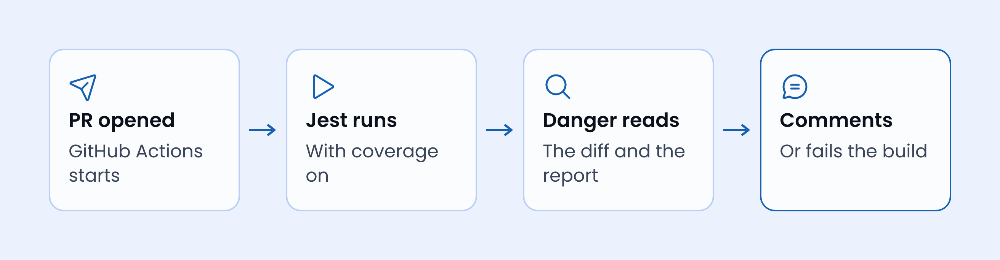
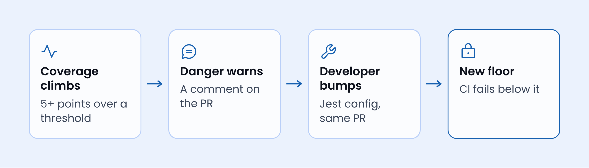
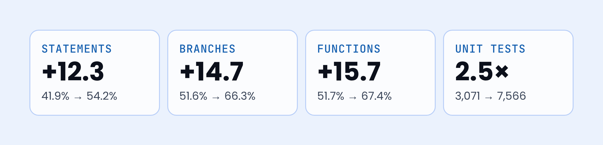

# Danger JS coverage ratchet

How to increase test coverage in a legacy codebase without a big rewrite: let every pull request do a little of the work.

This repo is a small, working example of a setup I used on a client project. Over two months it took unit test files from 353 to 637, and statement coverage from 41.9% to 54.2%. The write-up is on the NorthStar blog: [How to increase test coverage in a legacy codebase with Danger JS](https://northstardigitalconsulting.co.uk/blog/increase-test-coverage-legacy-codebase-danger-js).



The slides that go with the blog post are in [docs/northstar-danger-js-test-coverage.pdf](docs/northstar-danger-js-test-coverage.pdf).

## The three rules

[Danger JS](https://danger.systems/js/) runs in GitHub Actions on every pull request into `main`, after Jest has run with coverage.

| Rule | What it does | Blocks the merge? |
| --- | --- | --- |
| 1. Touch it, test it | Every changed source file under `src/` needs a test file, either next to it (`Basket.test.tsx`) or in `__tests__/`. | Yes |
| 2. Show the numbers | Posts a coverage table for just the files in the diff, marked against the Jest thresholds. | No |
| 3. Nudge the threshold | When global coverage is more than 5 points above a Jest threshold, warns the developer to raise it. | No |

Rule 1 only looks at files in the diff, so old code gets tests as people work on it. Rule 3 turns each improvement into a new floor: once a developer raises the threshold, Jest fails any later PR that drops below it.



## See it on real pull requests

| PR | What happens |
| --- | --- |
| [#1 Add gift wrap pricing](../../pull/1) | Adds `src/basket/giftWrap.ts` with no test. Danger fails the PR and lists the file. |
| [#2 Cover the legacy discount and shipping code](../../pull/2) | Changes two untested legacy files and adds their tests. Danger posts the coverage table and warns that every metric is now well above its threshold. |

## What's in the repo

```
dangerfile.js                  # entry point: runs the rules
danger/checkForTestFiles.js    # rule 1
danger/coverageReport.js       # rules 2 and 3
jest.config.cjs                # coverage thresholds, the single source of truth
.github/workflows/danger.yml   # runs Jest with coverage, then Danger
src/basket/                    # a tiny demo codebase, part tested, part legacy
```

## Add it to your project

1. Install Danger JS: `npm install --save-dev danger`
2. Copy `dangerfile.js` and the `danger/` folder into the root of your repo.
3. Set `SOURCE_DIR` at the top of both files in `danger/` to your source folder, for example `apps/web/src/` in a monorepo.
4. Make sure Jest writes `coverage/coverage-final.json` by including `json` in `coverageReporters`, and set `collectCoverageFrom` so untested files count against the total.
5. Set `coverageThreshold.global` just below today's numbers. Run `npx jest --coverage` to see them.
6. Copy `.github/workflows/danger.yml`. It uses the built-in `GITHUB_TOKEN`, so there are no secrets to add.

To try it locally against `main`:

```sh
npm install
npm run test:coverage
npm run danger:local
```

## Ignore rules and the escape hatch

`IGNORE_PATTERNS` in `danger/checkForTestFiles.js` skips files with nothing to unit test: type declarations, stories, generated code, icons and route files. Each rule carries a comment saying why, so a reviewer can question it.

For a genuine emergency, write `#skip-danger` in the PR description. Danger skips the checks and says so in its comment, so the skip shows up in review.

## Results on the original project



## Licence

MIT. Built by [Matt Claffey](https://northstardigitalconsulting.co.uk), NorthStar Digital Consulting.
